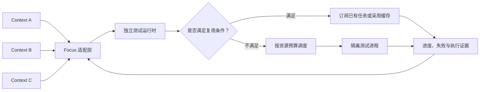

# Focus Test Runtime

面向多 Agent 的本地测试运行时。核心调度、快照、事件和证据存储使用 Go 标准库自行实现，不调用云端测试平台、调度服务或模型 API。Node 与 pytest 是本地兼容执行器。

## 已实现

- 固定输入：SHA-256 manifest、内容存储、包含未提交及 Git 忽略文件、变化检测、独立物化目录、输入修改复检。
- 集中调度：Request、Job、Attempt 分离，按 Context 轮转和同 Context FIFO，CPU/内存准入、独占资源、在途合并。
- 生命周期：请求独立取消和期限、执行期限、同步落盘的带校验事件日志、幂等重试和重启恢复。
- 真实执行：Node 内置测试与 pytest，逐阶段失败事件、完整报告校验、零用例保护和日志分页。
- 进程管理：Windows Job Object 在恢复测试进程执行前绑定；POSIX 进程组，Linux 额外回收收养的后代。
- 本地访问：loopback HTTP、独立凭据文件、CLI 和实验性的 Focus Python 客户端。

`fixture-v1` 是内置模拟器，结果标记 `mode: "simulation"`。Node/pytest 的 `mode` 是 `local-process`。本地进程具有当前用户的权限；目录副本和进程树管理不提供文件或网络沙箱。`focus-broker` 尚未实现，请求该策略会被拒绝。

## 架构基准



缓存是目标架构的一部分，目前只实现模拟任务的在途合并。真实 Node/pytest 执行要求 `reuse_policy: "none"`，直到 Python 安装包、原生库等外部依赖闭包可以核验。已经完成的结果不会被新请求复用；同一幂等提交的重试仍返回原记录。

## 启动与真实测试

需要 Go 1.26+。可选运行器为 Node 24+ 和已安装 pytest 的 Python。以下示例使用 PowerShell 7，在仓库根目录执行。

终端一：

```powershell
go run ./cmd/focus-testd --cpu-units 2 --memory-mib 1024
```

默认地址 `http://127.0.0.1:7337`。默认数据目录 `.focus-test`，其中 `token` 保存本地凭据，`state` 保存带校验日志，`snapshots` 保存 manifest、内容对象和执行目录。CLI 自动读取该凭据。自定义位置时使用服务的 `--data-dir` 和 CLI 的 `--token-file`。

终端二，封存并执行真实 Node 测试：

```powershell
go run ./cmd/focus-test health
go run ./cmd/focus-test capabilities
$sealedInput = go run ./cmd/focus-test snapshot --source examples/node | ConvertFrom-Json
go run ./cmd/focus-test plan --snapshot $sealedInput.snapshot_id --adapter node-v1 --tests sample.test.cjs --caller context-a > .focus-test/node-request.json
$testSubmission = go run ./cmd/focus-test submit-execution --file .focus-test/node-request.json | ConvertFrom-Json
go run ./cmd/focus-test events --job $testSubmission.job_id --after 0
go run ./cmd/focus-test request --request $testSubmission.request_id
go run ./cmd/focus-test logs --request $testSubmission.request_id --stream stderr --offset 0
```

任务未结束时继续查询 `request` 或用 `events --after N` 续读。撤销当前请求使用 `cancel --request ID`；同一 Job 的其他订阅继续。CLI 非零退出表示命令或通信失败，测试结论在 JSON 的 `outcome` 中。

pytest 的对应命令：

```powershell
$sealedPython = go run ./cmd/focus-test snapshot --source examples/pytest | ConvertFrom-Json
go run ./cmd/focus-test plan --snapshot $sealedPython.snapshot_id --adapter pytest-v1 --tests test_sample.py --caller context-python > .focus-test/pytest-request.json
go run ./cmd/focus-test submit-execution --file .focus-test/pytest-request.json
```

`plan` 从守护进程读取环境身份，包含可执行文件、适配脚本和环境变量摘要；环境发生变化时重新生成计划。环境变量只将哈希写入请求和日志，不将原值持久化。pytest 禁用自动加载第三方插件，保持单进程 fixture 范围；当前不接受额外运行参数。

## 快照与复用边界

`snapshot --source DIR [--store DIR] [--exclude path1,path2]` 进行两轮内容核验，输出 `verified_copy` manifest。它不承诺文件系统原子快照，Focus 仍需提供合作写屏障。默认排除根目录的 `.git`、`.focus-test` 和源目录内的内容存储；不使用 Git ignore 自动省略测试数据。

单份输入上限为 10000 个文件/目录、256 MiB；链接、junction、特殊文件和越界路径被拒绝。物化目录使用文件复制，不共享可写硬链接。生成的输出可留在执行目录，原始声明输入被修改会使通过结论失效。

`execution-key --file request.json` 仅计算声明输入的规范身份，不是执行证明。工作区路径、Git HEAD、Context 和请求等待期限不能单独充当复用键。

旧的 `submit --file examples/fixture-request.json`、`result --job ID` 仍可运行。新的封存模拟任务可用 `plan --adapter fixture-v1 --tests fixture.fail,fixture.slow --reuse inflight` 验证多个调用方的合并和独立取消。请求必须在同一 Job 仍运行时重叠才会合并。

## 可靠性与保留

终态同时包含实际退出状态、报告完整性、清理状态、输入身份及原始 Job/Attempt。错误、取消、超时、零用例、报告缺失或输入修改不能变成通过。`result_digest` 识别原始执行结果；每个订阅请求保留独立身份。

单个状态目录只允许一个进程持锁。重启不会重跑未结算任务：它们变为 `interrupted/inconclusive`。未结算的真实进程保留 `cleanup_status: unknown` 并隔离新调度，等待核实；不把重启当作进程清理证明。

日志先同步落盘再对外可见。损坏、截断或超过配额的证据日志使服务拒绝继续发布可信结果。每个输出文件的观测限额为 4 MiB，周期检测并停止超限进程，快速写入可能超过该阈值后才被停止。日志读取每页最多 64 KiB。

目前保留最多 128 个请求、64 MiB 状态日志，不自动删除已引用证据，也不自动做磁盘垃圾回收。CPU 和内存数值用于调度准入，不是操作系统硬限制。POSIX 进程组不能约束主动脱离进程组的程序。

## 检查与实验

```powershell
gofmt -w cmd internal adapters
go vet ./...
go test ./...
go build ./cmd/...
python -m unittest discover -s integration/focus -v
go run ./cmd/focus-test-bench --output benchmarks/latest.json
```

Windows 当前工具链未启用 CGO，race detector 由 Linux CI 配置覆盖。本机实际验证不代表远程 CI 已运行。Go 模块没有第三方依赖；pytest 是可选本地执行器及 CI 测试依赖。

对照实验详见 [benchmarks](benchmarks/README.md)，现有数据仅用于验证模拟协调机制，不代表真实 Focus 或项目测试加速比例。

## 实施状态

[实施路线](docs/roadmap.md) 记录逐项状态。[设计基线](docs/design.md) 保留架构和证据约束。

M0、M1 与 Node/pytest 本地适配已落地。M2 的自动保留清理、真实磁盘故障注入和跨平台实跑仍待完成。Focus 目前只有 [实验客户端和接入合同](integration/focus/README.md)，尚未修改 Focus 本体、建立受治理执行代理或验证模型消费。真实 Focus 验收与实负载收益实验仍在后续阶段。
