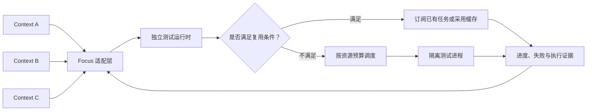

# Focus Test Runtime

面向多 Agent 的本地测试运行时。目标是让 Focus 的多个 Context 共享测试调度、合并相同工作，并提前获得失败与可追溯的执行证据。

核心机制自行实现，不依赖云端测试平台、调度服务或模型 API。当前 Go 模块只使用标准库。

## 当前状态

仓库初始化已包含 CLI、常驻服务、版本化协议，以及可运行的模拟测试链路：提交任务、查询增量事件、读取最终结果、幂等重试和关闭服务时取消待处理模拟任务。

**当前仅运行内置模拟用例。** 响应均带 `mode: "simulation"`；模拟的 `passed` 不能证明项目测试通过，也不能作为 Focus 完成验收证据。任务保存在内存中，重启后丢失；同一服务进程最多保留 128 个模拟任务，由单个 worker 顺序处理。

快照封存、跨请求合并、资源公平调度、持久化、订阅取消、真实测试进程和 Focus 接入均在后续里程碑中。幂等重试仅恢复同一个提交，不等于跨 Context 去重。

## 架构基准

遵循原始需求的调用链和反馈链。以下是目标架构，复用与资源调度分支尚未实现。



每个调用方的测试请求与实际执行任务必须分开建模。共享执行保留原始身份，调用方通过独立采纳记录使用结果。

## 本地启动

需要 Go 1.26 或更新版本。开发目录为当前仓库根目录。

终端一启动模拟服务：

```powershell
go run ./cmd/focus-testd
```

默认地址为 `http://127.0.0.1:7337`。可用 `--listen 127.0.0.1:0` 自动选空闲端口，实际地址打印在启动日志中；服务只接受字面形式的 loopback IP。

终端二查看健康状态并运行示例：

```powershell
go run ./cmd/focus-test health
go run ./cmd/focus-test version
$fixtureSubmission = go run ./cmd/focus-test submit --file examples/fixture-request.json | ConvertFrom-Json
go run ./cmd/focus-test events --job $fixtureSubmission.job_id --after 0
go run ./cmd/focus-test result --job $fixtureSubmission.job_id
```

自定义地址时，把全局参数放在子命令前，例如 `go run ./cmd/focus-test --addr http://127.0.0.1:7440 health`。

示例先产生失败，再运行慢用例，最后通过一个用例。最终预期为 `status: "completed"`、`outcome: "failed"`、`completed: 3`、`failed: 1`。任务完成前 `result` 返回当前进度，重复查询即可。`events --after N` 只读取序号大于 N 的事件；以返回的 `next_seq` 续读。

同一幂等键和相同负载返回原任务；改动负载时也要改幂等键，否则返回冲突。新幂等键会创建新任务。CLI 的非零退出表示命令或通信失败；模拟任务失败通过 JSON 中的 `outcome` 表示。

## 构建与检查

```powershell
gofmt -w cmd internal adapters
go vet ./...
go test ./...
go build -o bin/focus-test.exe ./cmd/focus-test
go build -o bin/focus-testd.exe ./cmd/focus-testd
```

Linux 和 macOS 构建时可省略输出文件名中的 `.exe`。支持 race detector 的本机工具链可额外运行 `go test -race ./...`；CI 在 Linux 上执行此检查。

## 目录

| 路径 | 职责 |
| --- | --- |
| `cmd/focus-test` | CLI 入口 |
| `cmd/focus-testd` | 服务启动和关闭 |
| `internal/protocol` | 模拟协议类型及输入校验 |
| `internal/runtime` | 模拟任务状态、幂等提交和事件 |
| `internal/server` | 本地 HTTP 接口 |
| `internal/cli` | CLI 命令与 HTTP 客户端 |
| `internal/localnet` | 共享 loopback 地址边界 |
| `adapters/fixture` | 确定性的模拟执行器 |
| `examples` | 可直接提交的示例 |
| `protocol` | 当前协议及未来真实执行协议边界 |
| `docs` | 研发设计、进度与实施顺序 |

开发从 [实施路线](docs/roadmap.md) 继续，架构与证据约束见 [研发设计](docs/design.md)。
