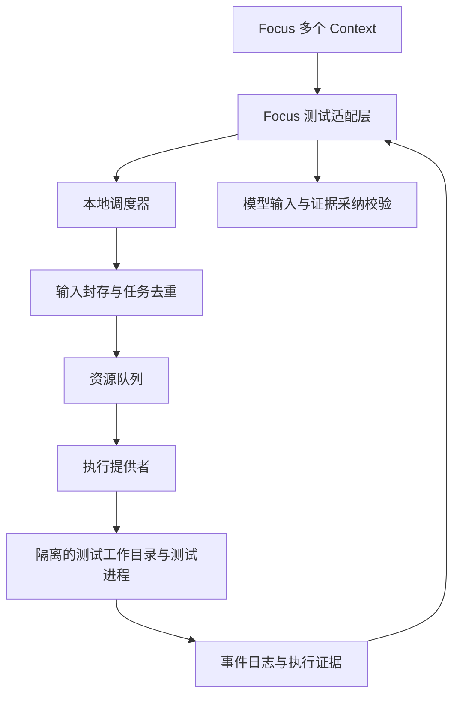

# Focus 多 Agent 测试运行时研发设计

来源：[设计 Page](https://chatgpt.com/space/page_527b8ca688f88191bf50fd51eb8b4d2f)。这是研发基线，功能状态以仓库实施记录为准。

建议研发独立的本地测试运行时，暂称 `focus-test-runtime`。它为多个 Agent 统一接收测试需求、封存执行输入、分配资源、合并完全相同的工作，并返回可追溯的增量事件和最终证据。Focus 负责调用方授权、Context 与 Run 绑定、模型消息投递和完成验收。

首版研究问题是：在相同机器预算、相同测试范围与相同输入条件下，集中调度能否减少重复执行和资源争抢，并缩短 Agent 得到可行动失败的时间。跨会话代码经常不同，因此去重命中率必须实测；不能把模拟的完全重复负载当成真实 Patrol 收益。

设计基线为 2026 年 10 月 27 日核验的 [Focus main 提交 ec2201f](https://github.com/Leeminjing/Focus/commit/ec2201f395696e635cedf72eb486cb102047c178)。实施进度以 README.md 和 docs/roadmap.md 为准。

“不调用现成 API”在本设计中指不依赖测试平台、云端调度或模型服务 API，核心调度、去重、快照、状态机与协议自行实现。允许语言标准库、操作系统接口和本地测试程序；pytest 与 Node 报告接口属于可选兼容层。

## 源码核验与方案修正

| 现状 | 已核验的源码 | 对研发的影响 |
| --- | --- | --- |
| Shell 工具等待后端返回后才形成完整结果 | [workspace_tools.py](https://github.com/Leeminjing/Focus/blob/ec2201f395696e635cedf72eb486cb102047c178/backend/packages/harness/focus/tools/builtins/workspace_tools.py#L315-L428) | 新增异步测试工具；单靠给原命令加后台参数不足以完成结果归属 |
| 执行请求默认超时 120 秒，工具输出超过 30000 字符截尾 | [contracts.py](https://github.com/Leeminjing/Focus/blob/ec2201f395696e635cedf72eb486cb102047c178/backend/packages/harness/focus/sandbox/contracts.py#L28-L36) 和 [workspace_tools.py](https://github.com/Leeminjing/Focus/blob/ec2201f395696e635cedf72eb486cb102047c178/backend/packages/harness/focus/tools/builtins/workspace_tools.py#L370-L392) | 测试任务需要独立期限、完整日志与分页摘要 |
| ContextRunPool 按 Run 数量分配容量 | [context_run_pool.py](https://github.com/Leeminjing/Focus/blob/ec2201f395696e635cedf72eb486cb102047c178/backend/app/desktop/patrol/agent_loop/resources/context_run_pool.py#L24-L69) | 增加测试资源调度，但保留原有 Run 调度职责 |
| 桌面测试脚本使用内部并发 4，并附加找到的全部测试文件 | [run-tests.cjs](https://github.com/Leeminjing/Focus/blob/ec2201f395696e635cedf72eb486cb102047c178/desktop/scripts/run-tests.cjs#L6-L16) | 定向测试需独立构造准确文件列表；不能假定给现有 npm test 追加文件就缩小范围 |
| 测试领域结果来自完整工具消息，报告截断或协议不完整时不证明通过 | [tests.py](https://github.com/Leeminjing/Focus/blob/ec2201f395696e635cedf72eb486cb102047c178/backend/app/desktop/runs/evidence/tests.py) 和 [run_activity_bridge.py](https://github.com/Leeminjing/Focus/blob/ec2201f395696e635cedf72eb486cb102047c178/backend/app/desktop/patrol/agent_loop/execution/run_activity_bridge.py#L214-L227) | 增量事件与最终验收证据使用不同生命周期 |
| inbox 在模型调用前消费消息 | [inbox.py](https://github.com/Leeminjing/Focus/blob/ec2201f395696e635cedf72eb486cb102047c178/backend/app/desktop/agents/inbox.py#L79-L95) | 记录模型实际消费时间；前端出现失败不是 Agent 已收到失败 |
| 普通集成测试可用 session 数据库，部分运行时测试另建逐用例数据库并迁移 | [conftest.py](https://github.com/Leeminjing/Focus/blob/ec2201f395696e635cedf72eb486cb102047c178/backend/tests/conftest.py#L55-L106) | 先测收集、建库、迁移成本，按 fixture 边界执行 |
| 已有工作区内容指纹、读写租约和隔离 slot | [fingerprints.py](https://github.com/Leeminjing/Focus/blob/ec2201f395696e635cedf72eb486cb102047c178/backend/app/desktop/workspaces/coordination/fingerprints.py) 和 [leases.py](https://github.com/Leeminjing/Focus/blob/ec2201f395696e635cedf72eb486cb102047c178/backend/app/desktop/workspaces/coordination/leases.py) | 对接现有稳定版本边界；另建执行输入 manifest，不直接复用其 digest 当缓存键 |
| 完成验收要求结算的 Run、匹配的工作区版本、路径、命令证明与能力 | [completion_sources.py](https://github.com/Leeminjing/Focus/blob/ec2201f395696e635cedf72eb486cb102047c178/backend/app/desktop/patrol/agent_loop/completion/completion_sources.py#L49-L104) | 外部运行时证据需要专门采纳类型及校验分支，原有解析器不能直接接受 |
| Shell 后端承担访问模式和进程清理证明 | [windows.py](https://github.com/Leeminjing/Focus/blob/ec2201f395696e635cedf72eb486cb102047c178/backend/packages/harness/focus/sandbox/windows.py) 和 [posix.py](https://github.com/Leeminjing/Focus/blob/ec2201f395696e635cedf72eb486cb102047c178/backend/packages/harness/focus/sandbox/posix.py) | 守护进程不能绕过 Focus 权限；工作目录隔离与文件沙箱是两项能力 |

原建议的主要方向成立，但有三处需要收紧：Go 的选择不构成加速证据；相同 Git HEAD 不构成相同输入；“加一个薄适配层”不足以覆盖异步任务所有权、访问控制和完成证据采纳。

## 首版范围与职责

首版采用 Go 本地常驻调度器，原因是便于分发独立程序并管理本地并发与进程；测试性能主要取决于负载、分组与准备成本，研发实验不预设语言带来的收益。标准库 `os/exec` 提供进程启动和管道，进程树生命周期仍需平台实现。[Go 官方文档](https://pkg.go.dev/os/exec)

首版交付固定输入、显式测试范围、全局资源准入、完全相同请求合并、失败事件、订阅取消、恢复与结构化结果。实际执行以一个测试组为单位，优先保留 fixture 与收集边界。

后续再做跨版本用例缓存、自动依赖分析、环境热复用、数据库模板、自适应分组和分布式执行。首版不开发新的 Python 或 JavaScript 断言语言。



| 模块 | 对外职责 | 内部实现边界 |
| --- | --- | --- |
| 输入封存 | 返回输入清单和内容身份 | 文件复制、内容存储、环境清单与一致性检查 |
| 调度器 | 接收请求并返回稳定请求身份 | 去重索引、订阅关系、资源准入、公平队列 |
| 执行提供者 | 启动、观察、取消并证明清理状态 | 本地进程或 Focus 管理的执行代理 |
| 测试适配器 | 将测试事件规范化 | 自带模拟执行器、Node reporter、pytest plugin |
| 证据存储 | 读取事件、最终结果与日志 | 顺序日志、结果原子发布、恢复、保留与清理 |
| Focus 适配层 | 绑定身份、通知模型、采纳结果 | Focus 授权和领域数据；运行时不直接写 Focus 数据库 |

独立模式使用本地进程执行提供者，供可信本地项目与实验使用。Focus 模式使用 Focus 管理的执行代理，遵守服务端授予的执行能力。两个模式必须报告各自的隔离能力，不能以临时目录冒充文件访问限制。

## 数据模型与复用规则

| 对象 | 身份 | 含义 |
| --- | --- | --- |
| TestRequest | request_id | 一个调用方对准确测试范围的需求，可独立取消和超时 |
| InputSnapshot | snapshot_id | 封存的文件字节、路径语义、配置与输入清单 |
| TestJob | job_id | 一项被调度的测试工作，可被多个请求订阅 |
| TestAttempt | attempt_id | 一次真实启动；重试创建新 attempt，旧证据不覆盖 |
| TestResult | result_digest | 终态、实际范围、报告完整性、环境与日志引用 |
| ResultAdoption | adoption_id | Focus 核验某请求可使用某原始执行结果的记录 |

request_id、Context 和 Run 身份用于归属，不放进可复用执行键。job_id 与 attempt_id 必须分开，否则恢复后的重新执行会混淆原始证据。

复用键采用有版本的规范编码后散列：

```text
execution_key = SHA256(
  schema_version,
  trust_domain,
  snapshot_manifest_digest,
  exact_test_plan_digest,
  environment_manifest_digest,
  adapter_id_and_version,
  execution_policy_digest,
  resource_execution_profile
)
```

规范编码规定字段类型、长度、排序与路径大小写语义；不能直接拼接无边界字符串。参数保留顺序，测试范围仅在适配器证明顺序无关时规范排序。实际 worker 数、随机种子、重试策略、超时、平台、运行器版本、依赖产物身份、环境变量及测试数据版本都属于可能影响执行的输入。

复用有三档：

| 策略 | 运行中的任务合并 | 已完成结果复用 |
| --- | --- | --- |
| none | 关闭 | 关闭 |
| inflight | 完全匹配且处于同一信任域时开启 | 关闭 |
| persistent | 完全匹配时开启 | 仅复用完整、通过、清理已确认的结果 |

默认 none；项目在明确输入边界和副作用隔离合同后启用 inflight，受控的确定性负载才启用 persistent。数据库、实时网络、时钟或随机数据未封存时，不能仅凭源码和 lockfile 宣称环境相同。lockfile 不等于安装产物内容。失败、取消、超时与报告不完整结果保留诊断证据，但不作为通过缓存。

取消事件和请求期限属于订阅；测试组的执行超时属于执行策略。一方较短的等待期限不能终止其他订阅者需要的任务。合并查询与创建任务必须在调度器同一串行状态变更中完成，避免两个同时到达的请求启动两次。

首版只合并完全相同范围。请求 A 为全套、请求 B 为一个文件时，即使有重叠也分别执行；子集复用需要证明 fixture、顺序和运行条件等价，留到后续。

## 输入封存与工作目录

Focus 的 workspace revision 是业务版本，fingerprint 是当前工作区观测值，snapshot_id 是运行时封存输入的身份；三者分开保存，并在请求绑定中建立关系。Focus 当前指纹实现包含文件内容和 Git 状态，但不等于测试运行环境的完整描述。[源码]( https://github.com/Leeminjing/Focus/blob/ec2201f395696e635cedf72eb486cb102047c178/backend/app/desktop/workspaces/coordination/fingerprints.py)

执行流程如下：

1. Focus 在已有 Run 的有效租约内建立短暂的封存边界，暂停该执行上下文的写入，记录 slot、revision 与所请求范围。不要在同一 writer lease 上再盲目申请不兼容 reader lease。

2. 运行时复制声明输入，边复制边计算摘要，生成 manifest；封存期间检查文件增删、类型、字节与版本变化。

3. Focus 在写屏障仍成立时确认来源绑定；有冲突则返回 input_changed，不启动任务。封存成功后解除写屏障，Agent 可以继续编辑。

4. 内容存储保留原始输入，为每次 attempt 物化独立的可写工作目录；测试缓存、临时文件和输出进入此目录或专用 scratch。

5. 启动前确认工作目录输入与 manifest 一致。运行期间修改声明输入会令最终结果失去通过复用资格；生成输出需在测试配置中明确区分。

普通文件复制不是文件系统原子快照。合作写屏障保证 Focus 管理的写入不会交错；不受管理的编辑器或外部进程仍可能写入。发现不稳定即拒绝启动；缺少受控边界时只声明“测试了封存包中的实际字节”，不声称它等于某个原子工作区版本。

首版默认拒绝越界符号链接、junction 和未支持的特殊文件；输入内链接、可执行位、大小写和换行字节必须有明确平台语义。禁止用可写硬链接把执行目录直接连到内容存储，否则测试可能污染其他任务。

未跟踪文件、忽略文件中的测试数据和本地配置不能按 Git ignore 一律剔除。项目需要声明输入边界；无法证明范围完整时关闭复用。依赖目录作为独立环境产物处理，不在每次提交时无条件复制全部依赖。不能保证只读复用的依赖按 attempt 隔离。

迁移测试仍执行迁移；测试过程中产生的源文件修改属于副作用，不能自动回写给 Agent 工作区。

## 接口与事件协议

本地传输建议使用仅绑定 loopback 的 HTTP，消息和流采用自定义 JSON 与 JSONL；这是本仓库实现的协议，不依赖外部服务。CLI 每次连接同一守护进程，不能为每个请求再启动一个独立调度器。Focus 请求凭据由桌面服务持有，模型不能自行签发执行许可。

| 操作 | 首版行为 |
| --- | --- |
| snapshot | 在指定执行提供者的合法边界内封存输入，返回 manifest 和快照身份 |
| submit | 接收已封存快照与准确测试计划，持久化请求后立即返回 request_id 和 job_id |
| events | 按 job_id 与 after_seq 读取增量事件；JSONL 流或有界长轮询 |
| result | 按 request_id 返回运行状态；终态返回不可变证据和复用来源 |
| cancel | 幂等地撤销当前请求的订阅 |
| logs | 按引用与偏移读取完整日志，不把整份日志塞进模型上下文 |

示意提交体如下。调用方身份由已认证连接绑定；Focus 的 Run 与 Context 映射保存在适配层，运行时只需要不透明 caller_ref。

```json
{
  "protocol_version": 1,
  "idempotency_key": "caller-generated-stable-key",
  "caller_ref": "opaque-focus-request-binding",
  "snapshot_id": "sha256:...",
  "plan": {
    "adapter": "fixture-v1",
    "test_ids": ["login.invalid_password", "login.valid_password"],
    "workers": 1,
    "seed": 7
  },
  "environment_id": "sha256:...",
  "execution_timeout_ms": 60000,
  "request_timeout_ms": 90000,
  "reuse_policy": "inflight",
  "resources": {
    "cpu_units": 1,
    "memory_mib": 256,
    "exclusive": []
  }
}
```

同一调用方使用相同幂等键和相同负载时返回原 request_id；相同键配不同负载必须冲突，不能静默修改旧请求。

```json
{
  "protocol_version": 1,
  "job_id": "job-...",
  "attempt_id": "attempt-...",
  "seq": 12,
  "kind": "case_failed",
  "snapshot_id": "sha256:...",
  "data": {
    "test_id": "login.invalid_password",
    "phase": "call",
    "file": "tests/login.test.js",
    "line": 42,
    "message": "expected rejection"
  }
}
```

规范事件包含 job_queued、attempt_started、collection_finished、case_finished、case_failed、group_finished、cleanup_finished、job_finished，以及收集、环境和协议错误。seq 在同一 job 内单调递增并跨 attempt 延续。事件先落盘后对外可见，客户端按 job_id 与 seq 去重。已清理的游标返回 cursor_expired 和终态读取指引，不能静默遗漏事件。

执行工作进程输出事件到专用协议通道，普通测试 stdout 与 stderr 分开归档。适配器为每条事件提供本地顺序身份，重复转发不会重复计数。日志按块写盘；慢订阅者不阻塞测试进程，必要时断开流并让其按游标补读。首个失败和终态及时刷盘，其他进度允许合并。

最终结果至少返回 outcome、execution_status、report_status、cleanup_status、snapshot_id、environment_id、plan_digest、attempt_id、执行/跳过/未执行范围、失败详情、日志引用、实际资源和 reused_from。日志引用必须可核验且可读取；证据与日志留存期限写入结果。零用例或未满足请求范围不能证明通过。

## 调度与任务生命周期

调度器采用单一状态所有者：网络并发读取，任务创建、订阅、取消、资源分配与终态发布在串行状态转换中完成。首版使用按调用方轮转的公平队列，调用方内部先进先出；已有等待任务不能被相同调用方的新任务无限插队。超出整机预算的单个任务立即返回 resource_unsatisfiable，避免永久排队。

资源一次性获取，包含 CPU 准入单位、内存估计和独占资源键。禁止拿到数据库锁后继续等待 CPU。资源不足允许有界跳过队头；大任务持续等待时为其预留后续释放的容量，防止小任务持续抢占。

CPU 和内存声明用于准入，属于估算，不能宣称已经实施操作系统硬限制。worker 数必须由适配器落实；对不支持控制内部并发的命令采取保守预算或独占执行。未知浏览器、数据库及线程库资源不能以 workers=1 认定只用一个 CPU。首版不运行中修改并行度，不抢占运行中的测试组。

请求状态为 attached、completed、cancelled、expired、rejected。执行状态与测试结论独立表示：

```text
Job: queued -> preparing -> running -> finalizing -> terminal

queued/preparing/running -> cancelling -> finalizing -> terminal
任意活动状态 -> recovering -> finalizing -> terminal

execution_status:
  exited | cancelled | timed_out | infrastructure_error | interrupted

outcome:
  passed | failed | inconclusive

report_status:
  complete | incomplete | unsupported

cleanup_status:
  confirmed | not_started | unknown
```

只有正常退出、退出码为零、报告完整、范围满足、输入绑定有效且清理 confirmed 才产生 passed。普通断言失败与收集、环境、协议故障区分；报告完整但用例失败，结论为 failed。适配器不支持解析的普通命令可保留退出事实，但不自动升级为有完整用例证明的 passed。

取消一个订阅只结束对应请求；其他订阅还在则继续执行。最后一个订阅离开时取消任务；任务期限从实际启动计算，请求期限从接受请求计算。连接断开不视为取消，断线调用方可以通过 request_id 恢复。

共享任务由运行时及执行代理管理，不能把操作系统进程生命周期挂在首个订阅 Run 上。Focus 撤销某请求授权时移除其订阅；执行域授权整体撤销时停止该域任务。只有清理已确认才归还独占资源；unknown 时隔离资源并暴露恢复需求。租约过期和父进程退出都不构成后代已退出的证明。

## 测试适配与故障恢复

第一条实现路径是自带模拟执行器：用确定性配置产生延迟通过、提前失败、收集错误、挂起、子进程、畸形报告和日志洪泛。模拟器用于验证框架行为，不能代替真实项目性能实验。

第二条路径接入 Node 内置测试，第三条接入 pytest。每个适配器先声明收集范围、用例身份、阶段语义、并发控制、流式能力、报告闭合和环境输入。Node 使用版本匹配的自定义 reporter；pytest 使用 hook 区分 setup、call、teardown。setup 成功和 call 成功均不能覆盖后续 teardown 失败。收集错误与 session 退出状态必须进入最终结果。[Node reporter 文档](https://nodejs.org/api/test.html#custom-reporters) · [pytest hook 文档](https://docs.pytest.org/en/stable/reference/reference.html#pytest.hookspec.pytest_runtest_logreport)

流式 reporter 只能转发测试引擎已经产生的事件；运行器自己的缓冲可能推迟事件。需要测量用例失败、适配器观察、运行时持久化、Focus 投递与模型消费各个时间点，不能保证底层任何失败都立即可见。

数据存储首版采用文件系统：带长度、校验与序号的追加日志，原子发布的终态文件，以及可重建的内存索引。事件持久化失败时停止发布可信终态；磁盘满不能退化成“退出零所以通过”。缓存文件被截断、摘要不符或协议版本不兼容时视为未命中。

服务启动时获取单实例锁，先恢复再接受新任务。未完成启动意图不能直接重放；旧进程可能已经存在。执行提供者按稳定的 attempt 身份与进程启动身份核实，回收或隔离旧执行；单独 PID 不足以辨认进程，避免 PID 重用。无法核实则标记 interrupted 与 cleanup unknown，禁止发布通过或启动可能冲突的新任务。

Windows 使用受管理的 Job Object 追踪和终止后代，需在测试代码运行前完成归属；Job Object 本身不替代文件权限控制。POSIX 使用进程组；针对可信本地测试，明确普通进程组不能防止程序主动脱离，严格包含需要额外平台能力。[Windows 官方文档](https://learn.microsoft.com/en-us/windows/win32/procthread/job-objects) · [Focus POSIX 后端限制](https://github.com/Leeminjing/Focus/blob/ec2201f395696e635cedf72eb486cb102047c178/backend/packages/harness/focus/sandbox/posix.py)

日志、快照与结果按字节配额和保留期清理；活动 attempt、未确认清理对象及已被验收引用的证据固定保留。Focus 采纳时复制或固定原始证据，不能让后续缓存淘汰破坏完成事实。

## Focus 接入设计

本轮实现进度：新增 opt-in node-sealed-v1 的受限真实在途共享，以及 `integration/focus/feedback_middleware.py` 的可选图反馈。它以既有 `world_state_update / origin=runtime / scope=run` 保存测试观察，不伪装成用户授权或协作消息；在精确 typed checkpoint、实际请求可见消息与 request manifest 三方匹配且模型返回后记录回执。此路径仍是 advisory，尚未接入生产 AgentFactory/Patrol、Focus 执行代理、版本写屏障或验收 ResultAdoption。下列生产设计仍须实现，不能因实验图通过而移除现有验证器约束。

接入分两步，避免将调度实验与完成验收修改混为一个里程碑。

第一步增加 test_submit、test_events、test_result、test_cancel 工具。Focus 工具授权与原有 host_command 能力衔接，身份由服务端绑定。运行时事件进入专门测试活动入口；首个有效失败、阶段完成和最终完成可触发模型输入，普通进度合并。已有 inbox 提供消费边界，但测试事件类型、持久化与回执需要明确增加，不能伪装为来自用户的新指令。

执行代理由 Focus 桌面服务托管，持有受治理的测试执行身份和授权范围，与任一模型 Run 的取消信号分离。它负责快照路径授权、测试进程启动、增量事件和清理回执。现有 Shell 后端的请求与结果主要面向同步调用，接入需要扩展流式观察及后台执行生命周期；禁止仅由 Go 守护进程用自己的宿主权限启动任务。

第二步增加专用 test_runtime 证据来源和 ResultAdoption。原始执行与调用方采纳分别记录：

```text
原始执行：
  trust_domain + job_id + attempt_id
  snapshot + environment + plan + policy
  process_exit + report + cleanup + result_digest

调用方采纳：
  request_id + Context + Run + call_id
  workspace_id + slot_id + workspace_revision
  requested_snapshot + original_result_digest
  validator_version + adoption_reason
```

Focus 持久化原始执行证据，通过已认证代理的执行回执核验其来源；不能信任模型自行提交的一段结果 JSON，也不能只凭本地任意文件自述。采纳校验同时检查权限、请求范围、环境、快照等价、原始报告完整性与清理状态。订阅 Run 自身仍须满足结算要求，但不要求它拥有共享的操作系统进程。

现有 CompletionSourceValidator 的 test 分支继续核验原有 Shell 测试；新增分支仅服务有 ResultAdoption 的运行时结果，不全局放宽路径或 Run 匹配。结果在临时快照目录执行时，保留真实执行路径，通过 manifest 与来源绑定证明适用性，禁止改写成调用方工作区路径。

合并多个隔离工作区后，最终组合树形成新快照。A 与 B 分别通过不能证明合并后的树通过；需要对最终组合快照执行要求的验收范围。只有同一内容与同一环境、策略、范围满足复用合同，才允许采纳已有证据。

| Focus 改动位置 | 改动意图 |
| --- | --- |
| 工具装配及权限入口 | 新增异步测试工具与可信调用身份 |
| 工作区协调服务 | 封存屏障及 slot/revision/snapshot 绑定 |
| 受治理执行层 | 桌面服务拥有的测试执行代理、流式观察与进程清理 |
| 运行活动和 inbox | 测试事件持久化、去重、模型消费回执 |
| 测试领域数据 | 原始执行与 ResultAdoption 数据模型 |
| 完成验收 | 新来源资格检查和最终提交复检 |

新增路径名称在实施时按仓库放置规范确定；以上是职责修改清单，不能声称这些新接口目前已经存在。

## 研发顺序与可执行验收

| 里程碑 | 可运行交付 | 退出条件 |
| --- | --- | --- |
| M0 输入与协议 | Go CLI、守护进程骨架、manifest、模拟执行器、协议说明 | 输入字节变化必然改变身份；输入不稳定拒绝执行；submit 幂等 |
| M1 集中运行闭环 | 公平队列、订阅去重、增量事件、取消、持久化 | 两个相同请求一次启动；一方取消另一方继续；预算与独占资源约束成立 |
| M2 生命周期可靠性 | 进程树清理、重启恢复、日志背压和证据归档 | 挂起、崩溃、磁盘满、断线与报告截断均不能产生错误通过 |
| M3 真实测试适配 | Node 与 pytest 各一个完整适配器 | 准确范围、早失败、收集失败、teardown 失败、零用例均按合同结算 |
| M4 Focus 接入 | 测试工具、受治理执行代理、事件投递和采纳验收 | 失败进入模型下一次决策；临时路径证据合法采纳；旧版本拒绝 |
| M5 收益实验 | 重放脚本、原始数据、对照结果与结论 | 可复现实验能解释调度、去重、准备与通知各自的收益和成本 |

建议目录：

```text
cmd/focus-test/          CLI
cmd/focus-testd/         常驻服务
internal/runtime/       请求、订阅、调度和任务状态
internal/snapshot/      输入封存与内容存储
internal/runner/        执行提供者及平台进程控制
internal/evidence/      事件、结果、恢复与日志
adapters/fixture/       自带确定性实验执行器
adapters/node/          Node 测试适配
adapters/pytest/        pytest 测试适配
protocol/               版本化协议与兼容示例
integration/focus/      Focus 接入合同与验证夹具
benchmarks/             模拟与真实负载重放
```

至少覆盖以下行为场景：

| 场景 | 可观察断言 |
| --- | --- |
| A 与 B 同时提交相同输入 | request_id 不同，job_id 相同，实际启动计数为 1 |
| A 取消而 B 继续 | A 终态 cancelled，B 获得完整结果，进程不提前退出 |
| 相同 HEAD 下修改一个未提交字节 | snapshot_id 改变，不能复用旧通过 |
| 相同代码但运行器、环境变量、worker 或配置变化 | 执行键变化，或拒绝复用 |
| 测试等待时 Agent 编辑来源目录 | 旧测试继续使用已封存输入，新提交使用新输入 |
| 先通过 call 后 teardown 失败 | 任务 failed，不能采纳为 passed |
| 子进程挂起后取消或超时 | 确认整个受管进程集合清理后才归还资源 |
| 提交应答丢失后重试 | 相同幂等键返回原请求，不重复启动 |
| 事件重放或客户端断线 | 事件不重计数，游标补读无静默缺口 |
| 守护进程在启动意图后崩溃 | 恢复不盲目重复启动，不把未知任务判通过 |
| 报告不完整或日志被截断 | 保留失败事实，无法形成完整通过证明 |
| Focus 权限撤回或工作区变化 | 当前请求停止采纳；其他合法订阅按其授权处理 |
| 两个分支通过后合并树不同 | 不能继承为最终通过，必须验证组合快照 |

首个演示采用两个模拟 Context、一个提前失败用例和一个慢用例。它同时证明去重、提前观察、独立取消与版本隔离；这个演示不证明真实 Focus 工作负载已经加速。

## 性能实验与后续决策

实验按 1、2、4、8 个模拟 Context 重放负载，记录机器、运行器版本、CPU 和内存预算、内部 worker 数、测试顺序、随机种子及冷暖状态。预算固定后分别比较以下模式：

| 对照 | 用途 |
| --- | --- |
| 原始 Focus 风格的独立测试调用 | 测量现状；单独记录内部并发叠加 |
| 独立调用加相同全局资源预算 | 隔离“限制过度并发”带来的影响 |
| 集中调度但关闭去重 | 测量服务、快照与队列自身成本 |
| 集中调度加 inflight 去重 | 测量同时重复请求的可节省工作 |
| 集中调度加 persistent 复用 | 单独测量受控输入的完成结果缓存 |

每个模式都使用相同测试范围和同一封存输入；另列端到端封存成本，不能从集中方案中扣除。负载包含完全重复、部分重叠、互不相同、不同脏工作区、短测试、CPU 密集测试和带数据库准备的测试。冷启动、只有操作系统文件缓存、运行时已有结果缓存分别报告。

记录 submit_received、snapshot_sealed、attempt_started、case_failure_observed、event_persisted、focus_event_received、model_event_consumed、job_finished 与 cleanup_confirmed。单机时延使用单调时钟；来源无法给出真实断言发生时间时，只报告适配器最早观察时间。

核心指标包括首个失败到模型消费的时间、请求到模型消费的总时间、要求范围全部完成时间、实际执行次数、排队与封存耗时、收集与 fixture 准备时间、CPU 时间、受管进程集合峰值内存、日志量及进入模型的摘要体积。错误复用、版本串用、错误通过和未确认清理单独计数，任一出现都阻止启用结果复用。

重复运行并保留原始样本，报告中位数与尾部；样本不足时不把极端分位数当稳定结论。共享任务资源在总体计一次，调用方视图标记 shared，避免把同一 CPU 时间按订阅数重复累计。

实际决策依据如下：重复率低且快照成本高时，优先改善资源准入和失败摘要；准备阶段占比高时，再研究 fixture 分组和环境准备；失败观察早而模型消费晚时，优先改 Focus 的通知与等待边界。是否投资跨版本依赖分析，取决于真实测试选择收益及漏测风险，不能仅凭模拟重复请求得出。
